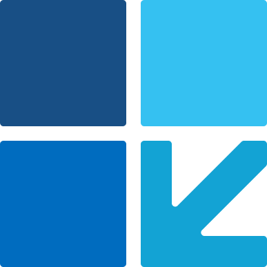

<div id="top"></div>

[![Contributors][contributors-shield]][contributors-url]
[![Forks][forks-shield]][forks-url]
[![Stargazers][stars-shield]][stars-url]
[![Issues][issues-shield]][issues-url]
[![GNU Affero General Public License v3.0 License][license-shield]][license-url]

<div align="center">
  
  <h3 align="center">WinUia</h3>
  <p align="center">
    A modern, high-performance C# library for Windows UI Automation, desktop app testing, and accessibility tooling.
    <br />
    <a href="https://github.com/buning-software/win-uia/issues">Report Bug</a>
    ·
    <a href="https://github.com/buning-software/win-uia/issues">Request Feature</a>
  </p>
</div>

<!-- TABLE OF CONTENTS -->
<details>
  <summary>Table of Contents</summary>
  <ol>
    <li>
      <a href="#about-the-project">About The Project</a>
      <ul>
        <li><a href="#built-with">Built With</a></li>
        <li><a href="#features">Features</a></li>
      </ul>
    </li>
    <li>
      <a href="#getting-started">Getting Started</a>
      <ul>
        <li><a href="#installation">Installation</a></li>
        <li><a href="#building-from-source">Building from source</a></li>
      </ul>
    </li>
    <li>
      <a href="#usage">Usage</a>
      <ul>
        <li><a href="#setting-up-your-application">Setting up your application</a></li>
        <li><a href="#limitations">Limitations</a></li>
      </ul>
    </li>
    <li><a href="#contributing">Contributing</a></li>
    <li><a href="#license">License</a></li>
  </ol>
</details>


## About The Project

WinUia is a .NET library for inspecting and automating Windows applications through the Microsoft UI Automation framework.

### Built With

* [.NET 10](https://dotnet.microsoft.com/)
* [Microsoft UI Automation](https://learn.microsoft.com/windows/win32/winauto/entry-uiauto-win32)

### Features

* **No dependencies:** talks to the native UIA3 COM API (`UIAutomationCore.dll`) through hand-written interop. No FlaUI, no interop packages.
* **Works across UI stacks:** WinForms, WPF, WinUI 3 (packaged and unpackaged), UWP and classic Win32 apps, x86 or x64.
* **Self-healing elements:** an element remembers how it was found and re-finds itself when a re-render makes it stale.
* **Waiting built in:** `Find` polls until the element appears (default 5 s), `TryFind` returns `null` instead of throwing.
* **Patterns first, mouse last:** `Click()` and `SetValue()` use UIA patterns (Invoke, Toggle, SelectionItem, ExpandCollapse, Value) and only fall back to `SendInput`.

## Getting Started
WinUia needs the [.NET 10 SDK](https://dotnet.microsoft.com/download) and Windows 10 or 11. Tests that drive an app need an interactive, unlocked desktop. Use Visual Studio 2022 or later, or any editor with the `dotnet` CLI; the Windows SDK is not required to use the package.

### Installation

```bash
dotnet add package WinUia
```

Optional: `WinUia.Recording` records the screen with ffmpeg while a test runs, so a failing CI test leaves a video.

```bash
dotnet add package WinUia.Recording
```

```csharp
// In your App page object: record every launch.
protected override AppLaunchOptions DefaultOptions => new() { Recording = new RecordingOptions() };
```

[ffmpeg](https://ffmpeg.org) is not bundled: install it and put it on `PATH`, or point the `WINUIA_FFMPEG` environment variable at `ffmpeg.exe`. Projects that don't use the package are unaffected. See the [package README](../src/WinUia.Recording/README.md) for keeping only failed tests and the other options.

### Building from source

```bash
git clone https://github.com/buning-software/win-uia.git
cd win-uia
dotnet build WinUia.slnx
dotnet test WinUia.slnx
```

The UI tests (the `*.UiTests` projects) launch an app and need an interactive desktop. Run only the others with `dotnet test WinUia.slnx --filter "FullyQualifiedName!~.UiTests."`.

## Usage

Test a calculator app in a few lines:

```csharp
using WinUia;

using var app = App.Launch(@"C:\path\to\Calculator.exe");   // or App.LaunchPackaged(appId), App.Attach(pid)

app.Find("btn2").Click();       // by AutomationId, then by Name
app.Find("btnPlus").Click();
app.Find("btn3").Click();
app.Find("btnEquals").Click();

Console.WriteLine(app.Find("txtResult").GetText());   // "5"
// Disposing a launched app closes it (Window pattern first, then kill).
```

`Element`'s own methods (`Click`, `SetValue`, `GetText`, `Toggle`, `Select`, `Expand`, `Collapse`) are the everyday API:
they check the element is enabled and pick the right pattern. The pattern wrappers (`element.TogglePattern.State`,
`element.WindowPattern.Close()`, ...) are for reading pattern state and for the members those methods do not cover.
Other windows of the app, such as dialogs, are found with `app.FindWindow("Save changes?")`, and any element can be
searched with a lambda: `window.Find(e => e.ControlType == ControlType.Button && e.Name == "Yes")`.

### Setting up your application

`examples/WinUia.Examples.Winforms.UiTests` is a complete test project for the WinForms app next to it. To do the same for your app:

1.  **Create a test project** that targets Windows and references `WinUia` and your test framework (the example uses NUnit).

2.  **Derive a class from `App`** that says which executable it is and how it starts, so tests launch it without repeating either. The example project builds the app first and passes its path in as assembly metadata; a fixed path works too.

    ```csharp
    using WinUia;
    using WinUia.Models;   // AppLaunchOptions

    public sealed class MyApp : App
    {
        protected override string ExecutablePath => @"C:\path\to\MyApp.exe";
        protected override AppLaunchOptions DefaultOptions => new() { ShowPointer = true };
    }
    ```

    The generic factories (`App.Launch<T>`, `App.Attach<T>`) create it already connected. `AppLaunchOptions` sets the arguments, working directory, environment, pointer and main-window timeout; options passed to a factory override those defaults one by one:

    ```csharp
    using var app = App.Launch<MyApp>();                                                          // its executable and defaults
    using var quiet = App.Launch<MyApp>(options: new AppLaunchOptions { ShowPointer = false });   // one default overridden
    using var other = App.Launch<MyApp>(@"D:\builds\MyApp.exe");                                  // another executable
    ```

3.  **Describe what is on screen with page objects.** The app owns the process, so it is the one thing you dispose. Pages are plain classes that read the app and own nothing, so they need no teardown. A page for part of the window, such as a tab, can derive from the main window's page and so reach its controls too:

    ```csharp
    public class MainForm(MyApp app)
    {
        public Element Window => app.MainWindow;
        public Element SaveButton => Window.FindByAutomationId("btnSave");
        public SettingsTab OpenSettings() { Window.FindByAutomationId("tabSettings").Select(); return new SettingsTab(app); }
    }

    public class SettingsTab(MyApp app) : MainForm(app)      // has SaveButton and OpenSettings() as well
    {
        public Element Content => Window.FindByAutomationId("lblSettings");
    }
    ```

### Testing

WinUia works with any test framework and ships no framework package, attribute or convention.

* **The desktop is shared automatically.** UI tests share one mouse, one keyboard focus and one foreground window, and `dotnet test` runs test assemblies in parallel. An `App` holds the desktop (`DesktopLock`) from `Launch` or `Attach` until it is disposed, across processes, so tests that drive apps take turns with no setup. How long a test waits for another process is `AppLaunchOptions.DesktopTimeout` (default 5 minutes). Dispose the app as soon as the test is done.
* **`DesktopLock.Acquire()`** is for holding the desktop longer, for example for a whole test run, or when you use `AutomationContext` directly without `App`. Locks nest within a process, so it combines with `App`.
* **`Poll.Until(condition, timeout)`** waits for UI state that the application updates asynchronously and returns whether it came true. Assert on the result with your framework's own assertion.

The rest is your framework's own: tag or group UI tests however you like so you can filter them (a category, a trait, or a separate test project), set timeouts with its timeout, and run on an MTA thread (UI Automation requires it). In NUnit:

```csharp
[assembly: Apartment(ApartmentState.MTA)]   // UI Automation requires MTA

// In a test: Assert.That(Poll.Until(() => page.ResultLabel.Name == "Clicked"), Is.True);
```

`examples/WinUia.Examples.Winforms.UiTests` is the complete NUnit setup. Recipes for xUnit and MSTest will follow.

### Project structure

WinUia is a modular monolith: one solution, one project per module, and one test project per module. Dependencies point one way, from the application layer down to the platform:

| Module | Layer | Contents | Depends on |
|---|---|---|---|
| `WinUia` | Application | `App` (launch, attach, find, close), `AppLaunchOptions`, `AppProcessException`; internal launchers | `WinUia.Core` (public API only) |
| `WinUia.Core` | Automation | `AutomationContext`, `Element` (lambda searches such as `Find(e => e.Name == "OK")`, self-healing locators), `WinUia.Patterns`, the `Uia*Exception` types, physical input (`WinUia.Input`: `IInputSimulator` and `Win32InputSimulator` via `SendInput`; each `AutomationContext` has one as `Input`, replaceable in tests), `Poll` and `DesktopLock` for tests of any framework, the UIA COM and Win32 interop | — |

Module rules:

* Each module's `Interop/` folder is private to that module. Other modules use what it offers (`IInputSimulator`), never its P/Invoke or COM declarations.
* Modules use each other's public API only, the same API an application built on WinUia gets.
* Internals are shared only through `InternalsVisibleTo`, and only with the module's own test projects.
* Folders group files by role (for example models, enumerations, exceptions, patterns, interop); a folder exists only when it has files, and test projects mirror the folders of what they test. Namespaces do not follow folders: public and internal types alike use `WinUia`, `WinUia.Patterns` and `WinUia.Input` (visibility is the `internal` keyword's job), except `Interop/`, which keeps its project's `.Interop` namespace as a fence, and `AppLaunchOptions`, which lives in `WinUia.Models`; tests follow project and folder. One type per file.
* Package versions are set once, in `Directory.Packages.props`.
* Every public member is listed in the package's `PublicAPI.Unshipped.txt` (moved to `PublicAPI.Shipped.txt` at release); the build fails on an unlisted change, so a public API change always shows in review.

Each module has up to three test projects under `tests/`, by what the tests need:

| Project | Tests | Needs |
|---|---|---|
| `<Module>.UnitTests` | The module's code on its own | Nothing |
| `<Module>.IntegrationTests` | Against the real UI Automation client, Win32 and other OS objects, without showing a window | Windows |
| `<Module>.UiTests` | Launch an app or move the real mouse and keyboard | An interactive, unlocked desktop |

Tests are selected by project name (`--filter "FullyQualifiedName~.UiTests."`), so
`dotnet test --filter "FullyQualifiedName!~.UiTests."` runs the unit and integration tests on any Windows machine. Every
`.UiTests` project gets a `DesktopLock` for the whole assembly from the build (`tests/Directory.Build.props`,
`tests/DesktopLockSetUp.cs`), because some of its tests move the real cursor without an `App`. UI tests launch
`tests/WinUia.TestApp`, an empty window, located through `tests/WinUia.Testing.Shared` (`AppPaths`). Tests of control
behaviour (patterns, searches, self-healing elements, dialogs, input) run against the WinForms example instead, in
`examples/WinUia.Examples.Winforms.UiTests`. Tests use NUnit.

`examples/` shows WinUia the way a user would use it: `WinUia.Examples.Winforms` is a WinForms app and
`WinUia.Examples.Winforms.UiTests` tests it with page objects, using only WinUia's public API and NUnit, nothing
from `tests/`. Examples and tests are independent: neither references the other.

### Limitations

* **MTA only:** UI Automation must be called from an MTA thread. Creating an `AutomationContext` (or launching an `App`) on an STA thread (for example a WinForms/WPF UI thread, or an `[STAThread]` `Main`) throws. Use `Task.Run` or a thread-pool thread.
* **Physical input needs a real desktop:** the mouse and keyboard fallbacks use `SendInput`, which does nothing on a locked workstation or a disconnected RDP session, and goes to whatever window is on top.
* **Elevation (UIPI):** a non-elevated process cannot send input to, and has limited UIA access to, an elevated app. Run the automation elevated when the target is.
* **DPI:** creating an `AutomationContext` makes the process per-monitor DPI aware (if it is not already) so UIA coordinates and `SendInput` both use physical pixels.

<!-- CONTRIBUTING -->
## Contributing

Contributions are what make the open source community such an amazing place to learn, inspire, and create. Any contributions you make are **greatly appreciated**.

If you have a suggestion that would make this better, please fork the repo and create a pull request. You can also simply open an issue with the tag "enhancement".
Don't forget to give the project a star! Thanks again!

1. Fork the Project
2. Create your Feature Branch (`git checkout -b features/feature-title`)
3. Commit your Changes (`git commit -m 'Added feature'`)
4. Push to the Branch (`git push origin features/feature-title`)
5. Open a Pull Request


<!-- LICENSE -->
## License
Distributed under the GNU Affero General Public License v3.0 License. See `LICENSE` for more information.


<p align="right">(<a href="#top">back to top</a>)</p>


<!-- MARKDOWN LINKS & IMAGES -->
<!-- https://www.markdownguide.org/basic-syntax/#reference-style-links -->
[contributors-shield]: https://img.shields.io/github/contributors/buning-software/win-uia.svg?style=for-the-badge
[contributors-url]: https://github.com/buning-software/win-uia/graphs/contributors
[forks-shield]: https://img.shields.io/github/forks/buning-software/win-uia.svg?style=for-the-badge
[forks-url]: https://github.com/buning-software/win-uia/network/members
[stars-shield]: https://img.shields.io/github/stars/buning-software/win-uia.svg?style=for-the-badge
[stars-url]: https://github.com/buning-software/win-uia/stargazers
[issues-shield]: https://img.shields.io/github/issues/buning-software/win-uia.svg?style=for-the-badge
[issues-url]: https://github.com/buning-software/win-uia/issues
[license-shield]: https://img.shields.io/github/license/buning-software/win-uia.svg?style=for-the-badge
[license-url]: https://github.com/buning-software/win-uia/blob/main/LICENSE
